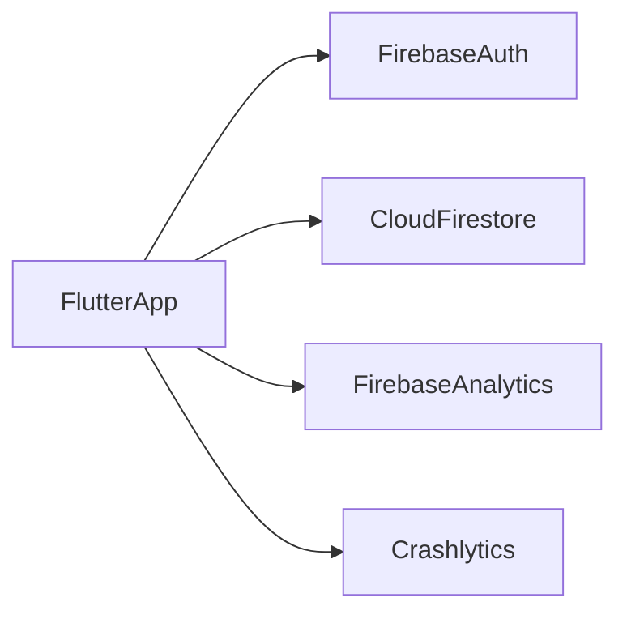

# Architecture — [App name]

Companion to [PRD.md](PRD.md). Conventions: [CONVENTIONS.md](CONVENTIONS.md).

**Source of truth:** this file owns **data shapes, Firestore paths, packages, and technical patterns**. Product rules (what the grocery list must do, offline policy, statuses) live in the PRD; this file links to them instead of restating them.

Clean Architecture with BLoC and injectable, in a **single Flutter package** (not a Melos monorepo). **No Dio/REST layer.** Backend is Firebase.

---

## 1. System context

There is no application server you write. The phone talks to Firebase.



| Actor | Role |
|-------|------|
| Flutter iOS + Android | UI, meal/grocery logic, search, bundled recipe catalog |
| Firebase Auth | Anonymous guest, Google, Apple; UID is the user id |
| Cloud Firestore | Catalog **updates** + per-user days/shopping/pantry |
| Firebase Analytics | Product events |
| Firebase Crashlytics | Crashes |
| Firebase Console / Google Cloud | Config, rules, OAuth, billing alerts |
| App Store Connect / Play Console | Distribution |

**V2 (not in this diagram):** Cloud Storage (photos), FCM, Remote Config, Cloud Functions.

**Environments:** two Firebase projects — **dev** and **prod**. `main_dev.dart` / `main_prod.dart` (or dart-defines) load the matching `FirebaseOptions`.

---

## 2. Key choices

| Concern | Choice |
|---------|--------|
| Packaging | **Single package**; layers are **folders** |
| Backend access | Firestore SDK; no `Dio` / `ApiClient` |
| State + DI | `flutter_bloc` + `injectable` + `get_it` |
| Presentation | Pages in `features/`, presentational views in `design_system/` |
| Errors | `Result<T>`, use cases, `*RepositoryImpl` |
| Dependency direction | Ports (abstract repositories, handlers) in `domain`; impls in `data` / `handlers`. **`domain` never imports `data`** |
| User data offline | Firestore offline persistence (this **is** the sync layer) |
| Recipe catalog | **Bundled JSON asset** + Firestore for updates; in-memory search |
| Analytics | Domain `AnalyticsHandler` port → `handlers/` adapter → Firebase Analytics |
| Not in MVP | OTA translations, Widgetbook, native bridge, Hive, Drift |

---

## 3. Layering

```
                 ┌─────────────────────────────────────┐
                 │              APP                    │
                 │  MaterialApp, go_router, GetIt init │
                 └──────────────┬──────────────────────┘
                                │
                 ┌──────────────▼──────────────────────┐
                 │           FEATURES                  │
                 │     BLoC, Pages (UI logic)          │
                 └──┬────────────────┬──────────────┬──┘
                    │                │              │
        ┌───────────▼───┐    ┌───────▼────────┐     │
        │ DESIGN_SYSTEM │    │    DOMAIN      │     │
        │ views, tokens │    │ use cases,     │     │
        │ AppFont, theme│    │ models, ports  │     │
        └───────────────┘    └───────▲────────┘     │
                                     │ implements   │
                             ┌───────┴────────┐     │
                             │     DATA       │     │
                             │ Firestore,     │     │
                             │ catalog, DTOs  │     │
                             └────────────────┘     │
                                                    │
                 ┌──────────────┬───────────────────┘
                 │ CORE         │ LOCALIZATION
                 │ Result, log, │ ARB EN / MR
                 │ env, except. │
                 └──────────────┘
```

**Dependency rule:** `features` → `domain` + `design_system`. `data` implements `domain` ports. **`domain` never imports `data`.**

**GetIt:** only the `app` layer reads the container (route `BlocProvider` → `getIt<SomeBloc>()`). Other layers use constructor injection via injectable annotations.

---

## 4. Folder tree (single package)

```
lib/
  app/                      # MaterialApp, theme wiring, DI init
    navigation/             # go_router, routes
    di/                     # configureDependencies, @InjectableInit
  handlers/                 # Analytics + Crashlytics adapters (implement domain ports)
  core/
    env/                    # AppConfig, Firebase project (dev/prod)
    helpers/                # Result<T>, AppException
    logger/
  design_system/
    tokens/                 # color, spacing, radius
    typography/             # AppFont enum — only way to apply fonts
    components/
    views/                  # presentational screens (props + callbacks)
    theme/
  localization/             # l10n EN/MR (or flutter gen-l10n at lib/l10n)
  domain/
    models/                 # Recipe, Ingredient, Meal, MealItem, Day, ShoppingList, …
    use_cases/
    repositories/           # abstract RecipeRepository, DayRepository, …
    handler/                # AnalyticsHandler, CrashHandler ports, AnalyticsEvent
      events/               # all analytics event classes, one file per feature
    failures/
  data/
    dtos/                   # Firestore / JSON maps
    repositories/           # *RepositoryImpl
    firestore/              # collection paths, converters
    catalog/                # bundled catalog loader, update merge, search index
    di/                     # Firebase.instance module
  features/
    auth/
    onboarding/
    home/
    recipes/
    plan/
    track/
    shopping/
    pantry/
    settings/
assets/
  catalog/catalog.json      # bundled recipes + ingredients (seed)
  recipes/{id}.webp         # bundled images
```

Each feature:

```
features/recipes/
  bloc/          # recipes_bloc.dart, recipes_event.dart, recipes_state.dart
  pages/         # recipes_page.dart — BlocBuilder → design_system view
```

---

## 5. Data flow

```
Page (features/)
  → BLoC (features/, @injectable)
    → UseCase (domain/)
      → Repository interface (domain/)
        → Repository impl (data/, @Singleton)
          → Firestore and/or bundled catalog
```

**Example: mark lunch eaten**

1. `HomePage` / `TrackPage` adds `MealMarkedEaten(date, MealType.lunch)`
2. `TrackBloc` calls `MarkMealEatenUseCase`
3. Use case sets `slots.lunch.status = eaten` and `statusChangedAt` on `users/{uid}/days/{date}` via `DayRepository` (field update, not whole-doc set). Item snapshots are already on the slot (§6)
4. Use case logs `MealMarkedEaten(mealType: lunch)` through `AnalyticsHandler`
5. The BLoC is subscribed to the day stream (§7), so the UI updates from the local cache immediately — online or offline

**Analytics are logged from use cases only** — not from BLoCs, pages, or widgets. This keeps one event per business action regardless of which screen triggered it.

**Example: search recipes**

1. Query runs **in memory** over the loaded catalog (normalized names + aliases, §6)
2. Opening a recipe reads the in-memory catalog; no Firestore read

This keeps Home and search off the Firestore read quota.

---

## 6. Data: cloud vs phone

### Recipe catalog (bundled + updates)

The catalog is small (MVP ~15–20, V1 ~40–80 recipes) and founder-curated, so it **ships inside the app**:

- `assets/catalog/catalog.json` — recipes + ingredients, with a `catalogVersion`
- On launch: load bundled JSON, then overlay any **downloaded updates** stored in a local JSON file (app documents dir via `path_provider`)
- Background check: read `meta/catalog.catalogVersion` from Firestore. If newer than local, query `recipes` / `ingredients` `where updatedAt > lastSyncedAt`, merge, save the local file, bump `lastSyncedAt`
- **Deletions** use tombstones: `deleted: true` on the document (never hard-delete catalog docs, or clients never learn about removal)
- Works on first launch **offline** — no catalog download required

**Search:** build an in-memory index at load: for each recipe, normalized `nameEn`, `nameMr`, `aliases[]` plus ingredient aliases. Normalize = lowercase, strip hyphens/extra spaces, Unicode NFC. Match by prefix/substring, then a small edit-distance fallback (e.g. ≤ 2) for transliteration variants (`pithla` / `pithale`). At < 500 recipes this is fast enough; revisit SQLite FTS only if the catalog grows a lot (and test Devanagari tokenization first).

**Firestore catalog docs** (updates only; same shape as the JSON):

- `recipes/{id}` — `nameEn`, `nameMr`, `aliases[]`, `baseServings`, `ingredientLines[{ingredientId, qty, unit}]`, steps (EN/MR), times, `regionIds[]`, diet tags, `seasonTags[]`, `festivalTags[]`, `occasionTags[]`, `imageAsset`, optional nutrition fields, `updatedAt`, `deleted`
- `ingredients/{id}` — `nameEn`, `nameMr`, `aliases[]`, `category`, `commonUnits[]`, optional `seasonalMonths[]`, `updatedAt`, `deleted`
- `meta/catalog` — `catalogVersion`

### User data (`users/{uid}`)

Firestore paths alternate collection / document, so profile and settings are **fields on the user document**, not sub-paths.

- `users/{uid}` (document) — `profile: { name?, language, diet, regionPreference, householdSize }`, `settings: { repeatPolicy, languageMode }`, `createdAt`
- `users/{uid}/days/{yyyy-MM-dd}` — **the single source of truth for planning, tracking, and history**:

  ```
  {
    date: "2026-11-04",
    slots: {
      breakfast:      { status, statusChangedAt, items: { <itemId>: MealItem } },
      morningSnack:   { ... },   // V1
      lunch:          { ... },
      eveningSnack:   { ... },   // V1
      dinner:         { ... }
    }
  }
  ```

  - MealItem recipe: `{ kind: "recipe", order, recipeId, servings, nameEn, nameMr }` — names are a **snapshot** taken when the item is added
  - MealItem manual: `{ kind: "manual", order, label, quantityText? }` — no grocery, no Recipe document
  - Items are a **map keyed by `itemId`** (with `order` for display), so two devices can edit different items without overwriting each other
  - A **week plan** = query 7 day docs (`date >= weekStart && date < weekStart+7`)
  - **History** = day docs for past dates. Because items carry snapshots, a catalog edit never changes history, and there is no second copy to keep in sync
- `users/{uid}/favourites/{recipeId}`
- `users/{uid}/shoppingLists/{weekStart}` — one active list per planned week:

  ```
  {
    weekStart: "2026-11-02",
    lines: {
      "d_onion_kg":  { source: "derived", ingredientId: "onion", unit: "kg", qty: 1.5, checked: false },
      "m_8f3a…":     { source: "manual", label: "Dish soap", qty: 1, unit: "pc", checked: true }
    }
  }
  ```

  - `lines` is a **map**, not an array, so check-off is a single field update (`lines.d_onion_kg.checked = true`)
  - Derived line key = `d_{ingredientId}_{unit}` — aggregation is by **ingredient ID + unit**. Same ingredient in two units → two lines (convert only when a known conversion exists in `commonUnits`)
  - Regenerate derived: recompute, then update/delete only `d_*` keys; keep `checked` for keys that still exist. `m_*` keys are never touched
- `users/{uid}/pantry/{ingredientId}`

Product rules for the grocery list: [PRD §16](PRD.md#16-grocery-list).

### Before Firebase: on-device store

Until Setup S2 connects Firebase, user data lives in `LocalDocumentStore` (`lib/data/local/`): one JSON file in the app's documents directory, shaped like Firestore so the switch only touches the data layer.

| Firestore | Local store |
|-----------|-------------|
| `users/{uid}/days/{date}` | `local_store.json` → `days` → `{date}`, same JSON |
| `doc.update({'slots.lunch.status': …})` | `update('days', date, {'slots.lunch.status': …})`, same dotted paths (`DayDto`) |
| `FieldValue.delete()` | `deleteField` |
| `doc.snapshots()` | `watch()` (emits now, then on every change) |
| `Timestamp` | ISO-8601 UTC string; converted in the repository |

`DayRepository` is the seam: `LocalDayRepository` today, `FirestoreDayRepository` later, with the same `DayDto` paths and JSON. Use cases and UI don't change. `local_day_repository.dart` notes the exact Firestore calls, including creating the document before `update()` and not using `set(merge: true)` for dotted fields.

**Migration on first Firebase launch:** after anonymous sign-in, if `local_store.json` exists, write each `store.all('days')` entry to `users/{uid}/days/{id}` (batched, `set` with the stored JSON, timestamps converted), then rename the file to `local_store.migrated.json`. Keep it until the next app version as a safety copy. This must run before Home subscribes to Firestore, so the first screen already shows the migrated data.

### Images (through V1)

Bundled assets, `assets/recipes/{id}.webp`. Field `imageAsset` points at the asset. Remote Storage is V2.

### Serving scale (domain use case)

`scaled = baseQty × (itemServings / recipe.baseServings)` — rule in [PRD §14](PRD.md#14-servings).

---

## 7. Firestore offline: implementation rules

Firestore offline persistence implements the [PRD §22](PRD.md#22-offline-and-v1-sync-policy) policy. To make it behave:

- **Never block the UI on a write.** With persistence on, the `Future` from `set()` / `update()` completes only when the **server** acknowledges. Offline, it never completes. Fire the write (`unawaited(...)`), attach a `catchError` that records to Crashlytics, and let the UI update from snapshot streams
- **Read via snapshot streams** (`snapshots()`), not one-off `get()`. Local writes appear in the stream instantly
- **"Waiting to sync":** use `snapshots(includeMetadataChanges: true)` and `metadata.hasPendingWrites` to drive the quiet indicator
- **No transactions** for user data — they fail offline. Use field-level `update()` (and `FieldValue.delete()`) so last-write-wins applies per field, not per document
- Prefer `update()` with dotted paths (`slots.lunch.status`) over `set()` of the whole document

---

## 8. Auth in code

| Step | Where |
|------|--------|
| `Firebase.initializeApp` | `app` bootstrap |
| `signInAnonymously` if `currentUser == null` | Auth repository, called at startup |
| `GoogleSignIn` / `SignInWithApple` → `linkWithCredential` | `LinkAccountUseCase` |
| `authStateChanges` | Auth repository stream → AuthBloc / router redirect |
| Account delete | `DeleteAccountUseCase` (below) |

**Link conflict:** `linkWithCredential` fails with `credential-already-in-use` → show the dialog described in [PRD §4](PRD.md#4-auth-and-personalization). Do not copy documents across UIDs.

**Account delete, in order:**

1. **Re-authenticate** if the provider is Google/Apple (Firebase throws `requires-recent-login` otherwise). Anonymous users skip this
2. **Apple only:** get a fresh authorization code via Sign in with Apple and call `FirebaseAuth.instance.revokeTokenWithAuthorizationCode(code)` (Apple requires token revocation on account deletion)
3. Delete Firestore data **while still signed in** (rules require auth): batched deletes of `days`, `favourites`, `shoppingLists`, `pantry`, then `users/{uid}`. Needs network
4. `currentUser.delete()`
5. Sign in anonymously again → fresh onboarding

---

## 9. Security rules (sketch)

```
rules_version = '2';
service cloud.firestore {
  match /databases/{database}/documents {
    function signedIn() { return request.auth != null; }
    function isOwner(uid) { return signedIn() && request.auth.uid == uid; }

    match /recipes/{id} {
      allow read: if signedIn();
      allow write: if false;
    }
    match /ingredients/{id} {
      allow read: if signedIn();
      allow write: if false;
    }
    match /meta/{doc} {
      allow read: if signedIn();
      allow write: if false;
    }
    // In rules v2, {document=**} matches zero or more segments,
    // so this covers users/{uid} itself and all subcollections.
    match /users/{uid}/{document=**} {
      allow read, write: if isOwner(uid);
    }
  }
}
```

Tighten `write` on user docs (schema validation) as the model stabilizes. Publish catalog updates via Console or a locked-down script using a service account — **not** from the mobile client.

---

## 10. Analytics and Crashlytics placement

```
lib/domain/handler/analytics_event.dart        # abstract AnalyticsEvent { name, params }
lib/domain/handler/analytics_handler.dart      # abstract log(AnalyticsEvent)
lib/handlers/firebase_analytics_handler.dart   # FirebaseAnalytics.logEvent
```

- Events are logged from **use cases** (§5), never from `design_system`, pages, or BLoCs
- iOS: do **not** link the `AdSupport` framework (no IDFA collection) and keep ad personalization signals off. Then no ATT prompt is needed. Re-check if you ever add ads
- Consent: `setAnalyticsCollectionEnabled(false)` until the user consents where required (see [PRD §31](PRD.md#31-legal-and-store-compliance)); use Consent Mode parameters
- Event names: [CONVENTIONS.md § Analytics events](CONVENTIONS.md#analytics-events)

Crashlytics:

- `runZonedGuarded` in `main_*`
- `FlutterError.onError`
- `PlatformDispatcher.instance.onError`
- `FirebaseCrashlytics.instance.recordError`

---

## 11. Localization

| Kind | Where |
|------|--------|
| Buttons, nav, errors | ARB `en`, `mr` |
| Recipe names, ingredients, steps | Catalog fields `nameEn` / `nameMr` (and aliases) |
| Language mode | `settings.languageMode`: `en` / `mr` / `en+mr` |

Marathi must be natural terminology (कांदा, तूर डाळ, ज्वारी पीठ), not literal translation.

---

## 12. Packages

**MVP pubspec**

| Package | Role |
|---------|------|
| `flutter_bloc` | Feature state |
| `get_it` + `injectable` + `injectable_generator` | DI |
| `go_router` | Navigation |
| `equatable` | Value equality |
| `firebase_core`, `firebase_auth`, `cloud_firestore` | Backend |
| `firebase_analytics`, `firebase_crashlytics` | Telemetry |
| `firebase_app_check` | Abuse protection |
| `google_sign_in`, `sign_in_with_apple` | Providers |
| `path_provider` | Local catalog-update file |
| `flutter_localizations` + `intl` | ARB |
| `build_runner` | injectable codegen |

**Do not add through V1:** `dio`, `riverpod`, `hive`, `drift`, `firebase_storage`, `firebase_messaging`, `cloud_functions`, `firebase_remote_config`, Mixpanel, Amplitude, Sentry, RevenueCat, phone auth, LLM APIs.

Fonts: as required by the design system, exposed only through `AppFont`.

---

## 13. Configure vs code

| Need | You configure | You code in Dart |
|------|---------------|------------------|
| Auth (Anonymous, Google, Apple) | Firebase Console → Auth; Android SHA-1/SHA-256; iOS URL schemes + `GoogleService-Info.plist`; Apple capability, Services ID, key; OAuth client IDs in Google Cloud | `signInAnonymously`, `linkWithCredential`, `authStateChanges`, delete flow (§8) |
| Firestore | Location **`asia-south1`** (cannot be changed later), `firestore.rules`, `firestore.indexes.json` | Repositories, DTOs |
| Analytics / Crashlytics | FlutterFire CLI / Console | Handler adapter, error hooks |
| App Check | Play Integrity / DeviceCheck / App Attest | SDK init |
| Budget alerts | Google Cloud Billing | — |
| Photos (V2) | Cloud Storage bucket (needs Blaze) | Skip through V1; use assets |
| Push / flags (V2) | FCM, Remote Config | Skip through V1 |

Security rules are the authorization layer.

---

## 14. Error handling

Use `Result<T>` (`Success` / `Failure`) for expected failures (permission, invalid data, network-required operations like account link/delete). BLoCs map failures to `ViewState.error` and a user-facing message from `AppException`.

Offline is **not** an error for user data (§7). Do not swallow errors; record unexpected ones in Crashlytics.

---

## 15. Testing (lightweight)

| Layer | What |
|-------|------|
| Domain use cases | Unit tests with fake repositories (servings, grocery aggregation, ranking, status transitions) |
| BLoCs | `bloc_test` |
| Repositories | `fake_cloud_firestore` |
| Search | Table tests: EN / MR / transliteration / hyphen / typo cases |
| Pages | Pump `design_system` views with fixtures |

No Widgetbook in MVP. Extract `design_system` to a package later if the catalog grows.

---

## 16. Extracting packages later

If the app grows, split folders into packages with the same names (`core`, `domain`, `data`, `design_system`, `features`). Do not start there: one `pubspec.yaml` until codegen and Firebase are boring.

---

*End of architecture.*
