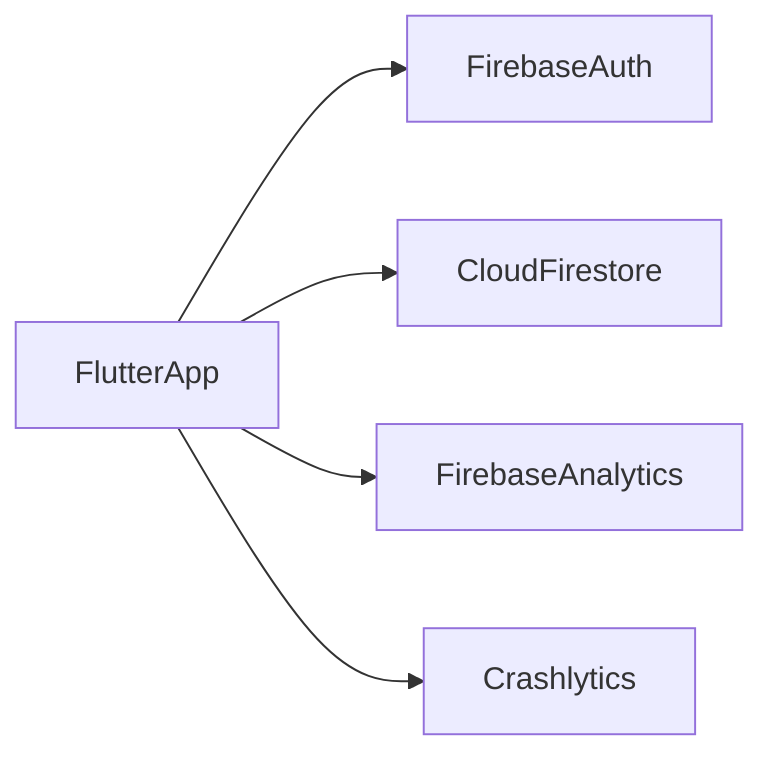

# Architecture — [App name]

Companion to [PRD.md](PRD.md). Conventions: [CONVENTIONS.md](CONVENTIONS.md).

This app **learns from** [reference/ARCHITECTURE.md](reference/ARCHITECTURE.md) (Clean Architecture, BLoC, injectable) but is **not** a Melos monorepo and has **no Dio/REST layer**. Backend is Firebase.

---

## 1. System context

There is no application server you write. The phone talks to Firebase.



| Actor | Role |
|-------|------|
| Flutter iOS + Android | UI, meal/grocery logic, search |
| Firebase Auth | Anonymous guest, Google, Apple; UID is the user id |
| Cloud Firestore | Shared recipe catalog + per-user plans/history/shop |
| Firebase Analytics | Product events |
| Firebase Crashlytics | Crashes |
| Firebase Console / Google Cloud | Config, rules, OAuth, billing alerts |
| App Store Connect / Play Console | Distribution |

**v2 (not in this diagram):** Cloud Storage (photos), FCM, Remote Config, Cloud Functions.

**Environments:** two Firebase projects — **dev** and **prod**. Optional `main_dev.dart` / `main_prod.dart` (or dart-defines) that load the matching `FirebaseOptions`. This replaces mock/staging **API** flavors from the other project.

---

## 2. What we keep vs change

| Other project | This app |
|---------------|----------|
| Melos packages (`app`, `features`, `domain`, `data`, …) | **Single package**, same layers as **folders** |
| `Dio` + `ApiClient` | Firestore + local recipe cache |
| `flutter_bloc` + `injectable` + `get_it` | **Same** |
| Pages in features, views in design_system | **Same** |
| `Result<T>`, use cases, `*RepositoryImpl` | **Same** |
| Domain depending on data (reference diagram) | **Forbidden** — ports in domain, impls in data |
| Phrase OTA, Widgetbook, native bridge | **Not MVP** |
| Hive as primary store | Firestore persistence for user docs; **Drift** for recipe FTS |
| Tracker package | Domain **handler** + `handlers/` adapter → Firebase Analytics |

---

## 3. Layering

```
                 ┌─────────────────────────────────────┐
                 │              APP                    │
                 │  MaterialApp, go_router, GetIt init │
                 └──────────────┬──────────────────────┘
                                │
                 ┌──────────────▼──────────────────────┐
                 │           FEATURES                  │
                 │     BLoC, Pages (UI logic)          │
                 └──┬────────────────┬──────────────┬──┘
                    │                │              │
        ┌───────────▼───┐    ┌───────▼────────┐     │
        │ DESIGN_SYSTEM │    │    DOMAIN      │     │
        │ views, tokens │    │ use cases,     │     │
        │ GAFont, theme │    │ models, ports  │     │
        └───────────────┘    └───────┬────────┘     │
                                     │              │
                             ┌───────▼────────┐     │
                             │     DATA       │     │
                             │ Firestore,     │     │
                             │ Drift, DTOs    │     │
                             └────────────────┘     │
                                                    │
                 ┌──────────────┬───────────────────┘
                 │ CORE         │ LOCALIZATION
                 │ Result, log, │ ARB EN / MR
                 │ env, except. │
                 └──────────────┘
```

**Dependency rule:** `features` → `domain` + `design_system`. `data` implements `domain` ports. **`domain` never imports `data`.** Only `app` uses `GetIt` to construct graphs (route `BlocProvider` → `getIt<SomeBloc>()`).

**GetIt:** only the app layer reads the container. Other layers use constructor injection via injectable annotations.

---

## 4. Folder tree (single package)

```
lib/
  app/                      # MaterialApp, theme wiring, DI init
    navigation/             # go_router, routes
    di/                     # configureDependencies, @InjectableInit
  handlers/                 # Analytics + Crashlytics adapters (implement domain ports)
  core/
    env/                    # AppConfig, Firebase project (dev/prod)
    helpers/                # Result<T>, AppException
    logger/
  design_system/
    tokens/                 # color, spacing, radius (map Design System 2.0)
    typography/             # GAFont enum — only way to apply fonts
    components/
    views/                  # presentational screens (props + callbacks)
    theme/
  localization/             # l10n EN/MR (or flutter gen-l10n at lib/l10n)
  domain/
    models/                 # Recipe, Ingredient, Meal, MealItem, WeeklyPlan, …
    use_cases/
    repositories/           # abstract RecipeRepository, PlanRepository, …
    handler/                # AnalyticsHandler, CrashHandler ports
    failures/
  data/
    dtos/                   # Firestore JSON maps
    repositories/           # *RepositoryImpl
    firestore/              # collection paths, converters
    local/                  # Drift: recipe FTS (EN, MR, aliases)
    di/                     # Firebase.instance module
  features/
    auth/
    onboarding/
    home/
    recipes/
    plan/
    track/
    shopping/
    settings/
```

Each feature:

```
features/recipes/
  bloc/          # recipes_bloc.dart, recipes_event.dart, recipes_state.dart
  pages/         # recipes_page.dart — BlocBuilder → design_system view
  tracker/       # optional feature events
```

---

## 5. Data flow

Same as the invoices example in the other project, with Firestore instead of HTTP:

```
Page (features/)
  → BLoC (features/, @injectable)
    → UseCase (domain/)
      → Repository interface (domain/)
        → Repository impl (data/, @Singleton)
          → Firestore and/or Drift
```

**Example: mark lunch eaten**

1. `HomePage` / `TrackPage` adds `MealMarkedEaten(date, MealType.lunch)` for the slot (the slot already has `meal_items[]`)
2. `TrackBloc` calls `MarkMealEatenUseCase`
3. Use case copies the slot into history **with name/servings snapshots** (and manual labels), then sets status `eaten`
4. `FoodHistoryRepositoryImpl` writes `users/{uid}/history/{date}`
5. BLoC maps `Result` → `ViewState.content` or error
6. `AnalyticsHandler.log(AppTrackMealMarkedEaten(...))` from the use case or a thin app handler — **not** from random widgets

**Example: search recipes**

1. Query hits **Drift FTS** (local catalog)
2. Catalog sync: on launch / when `recipesVersion` in Firestore changes, pull deltas into Drift
3. Opening a recipe may read Firestore only if the local row is stale

This keeps Home and search off the 50k reads/day quota.

---

## 6. Data: cloud vs phone

### Firestore

**Catalog**

- `recipes/{id}` — bilingual names, aliases, `ingredientLines[{ingredientId, qty, unit}]`, steps, times, `regionIds[]`, diet tags, season/festival/occasion tags, image asset key, `contentVersion`
- `ingredients/{id}` — `nameEn`, `nameMr`, `aliases[]`, category, `commonUnits[]`
- `meta/catalog` — `recipesVersion` (bump when you edit recipes in console)

**User** (`users/{uid}/`)

- `profile`, `settings`
- `plans/{yyyy-MM-dd}` Monday of week — each slot: `{ status, items: MealItem[] }`
  - MealItem recipe: `{ kind: recipe, recipeId, servings, nameEn, nameMr }`
  - MealItem manual: `{ kind: manual, label, quantityText? }` — no grocery, no Recipe document
- `history/{yyyy-MM-dd}` — same shape but **snapshots** (names/servings/labels frozen; catalog edits must not rewrite history)
- `favourites/{recipeId}`
- `shoppingLists/{id}` — V1: **one active list per planned week** (`id` = week start). Lines `{ source: derived | manual, ingredientId?, label, qty, unit, checked }`. Generate/update that document; do not create a new list on every generate. Manual lines and checked state survive derived regeneration. Collection shape allows V2 historical/multiple lists; V1 UI shows only the current week.
- `pantry/{ingredientId}`

A **meal is never a single `recipeId` field**. Grocery **derived** lines are rebuilt from plan recipe items; **manual** grocery lines are not deleted on regenerate. Join ingredients by **ID**, not by display string.

Enable **Firestore offline persistence** for user documents. This **is** the V1 sync layer.

**V1 sync policy (do not invent another):**

- Edits show immediately offline.
- Firestore queues writes and syncs when online.
- Cached catalog (Drift) + persisted user docs remain usable.
- Quiet “waiting to sync” if pending or failed — not a blocking error screen.
- No conflict-resolution UI. Same user, two devices, same document: **last write wins**.
- No Cloud Functions or extra sync service for offline.

### Drift (local)

- Indexed recipe + ingredient rows for search (`poha`, `पोहे`, `kanda pohe`, `kanda-poha`) plus aliases, case/space normalization
- Not the source of truth for “what I ate” — that is Firestore

### Images (through V1)

Asset catalog, e.g. `assets/recipes/{id}.webp`. Firestore field `imageAsset` points at the asset. Remote Storage is v2.

### Serving scale (domain use case)

`scaled = baseQty * (itemServings / recipe.baseServings)` where `itemServings` defaults to household size and is carried across recipe, plan, Cook Now, and grocery.  
Grocery **derived** lines sum by `ingredientId`. **Manual** grocery lines are never removed by regeneration.

---

## 7. Auth in code

| Step | Where |
|------|--------|
| `Firebase.initializeApp` | `app` bootstrap |
| `signInAnonymously` if `currentUser == null` | `features/auth` use case / repository |
| `GoogleSignIn` / `SignInWithApple` → `linkWithCredential` | `LinkAccountUseCase` |
| `authStateChanges` | Auth repository stream → AuthBloc / router redirect |
| Account delete | Auth + recursive delete of `users/{uid}` (client batched deletes or a later Function) |

**Conflict:** `linkWithCredential` fails with credential-already-in-use → UI: sign into existing account. Do not copy documents across UIDs. Successful link **must keep** the anonymous UID’s plans, history, favourites, pantry, and shopping lists.

See [PRD.md](PRD.md) §4.

---

## 8. Security rules (sketch)

```
rules_version = '2';
service cloud.firestore {
  match /databases/{database}/documents {
    function signedIn() { return request.auth != null; }
    function isOwner(uid) { return signedIn() && request.auth.uid == uid; }

    match /recipes/{id} {
      allow read: if signedIn();
      allow write: if false;
    }
    match /ingredients/{id} {
      allow read: if signedIn();
      allow write: if false;
    }
    match /meta/{doc} {
      allow read: if signedIn();
      allow write: if false;
    }
    match /users/{uid}/{document=**} {
      allow read, write: if isOwner(uid);
    }
  }
}
```

Tighten `write` on user docs (schema validation) as the model stabilizes. Seed catalog via Console (authenticated as admin) or a locked-down script using a service account — **not** from the mobile client.

---

## 9. Analytics and Crashlytics placement

```
domain/handler/analytics_handler.dart     # abstract log(TrackerEvent)
lib/handlers/firebase_analytics_handler.dart  # FirebaseAnalytics.logEvent
```

Crashlytics:

- `runZonedGuarded` in `main_*`
- `FlutterError.onError`
- `PlatformDispatcher.instance.onError`
- `FirebaseCrashlytics.instance.recordError`

Do not call `FirebaseAnalytics` from `design_system`. Features and use cases depend on the **port**.

Event names: [CONVENTIONS.md](CONVENTIONS.md) § Tracker events.

---

## 10. Localization

| Kind | Where |
|------|--------|
| Buttons, nav, errors | ARB `en`, `mr` |
| Recipe names, ingredients, steps | Firestore fields `nameEn` / `nameMr` (and aliases) |
| Language mode | Profile: `en` / `mr` / `en+mr` |

Marathi must be natural terminology (कांदा, तूर डाळ, ज्वारी पीठ), not literal translation.

---

## 11. MVP packages

| Package | Role |
|---------|------|
| `flutter_bloc` | Feature state |
| `get_it` + `injectable` + `injectable_generator` | DI |
| `go_router` | Navigation |
| `equatable` | Value equality |
| `firebase_core`, `firebase_auth`, `cloud_firestore` | Backend |
| `firebase_analytics`, `firebase_crashlytics` | Telemetry |
| `google_sign_in`, `sign_in_with_apple` | Providers |
| `drift` + `sqlite3_flutter_libs` | Recipe FTS |
| `flutter_localizations` + `intl` | ARB |
| `build_runner` | injectable + Drift |

**Not in MVP pubspec:** `dio`, `riverpod`, `hive` (unless you prefer it over Drift — default is Drift), `firebase_storage`, `firebase_messaging`, `cloud_functions`.

Fonts: as required by Design System 2.0, exposed only through `GAFont`.

---

## 12. Configure vs code

| Task | Where |
|------|--------|
| Enable Anonymous, Google, Apple | Firebase Console → Auth |
| Android SHA-1 / SHA-256 | Firebase / Play App signing |
| iOS URL schemes, `GoogleService-Info.plist` | Xcode + Firebase |
| Sign in with Apple | Apple Developer: capability, Services ID, key |
| OAuth client IDs | Google Cloud Console |
| Firestore indexes (compound filters) | Console or `firestore.indexes.json` |
| Security rules | `firestore.rules` |
| Analytics / Crashlytics | FlutterFire CLI / Console |
| Budget alerts | Google Cloud Billing |
| Sign-in, repositories, events, BLoCs | Dart |

---

## 13. Error handling

Use `Result<T>` (`Success` / `Failure`) for expected failures (network, permission, empty catalog). BLoCs map failures to `ViewState.error` and a user-facing message from `AppException`.

Do not swallow errors; record unexpected ones in Crashlytics.

---

## 14. Testing (lightweight)

| Layer | What |
|-------|------|
| Domain use cases | Unit tests with fake repositories |
| BLoCs | `bloc_test` |
| Repositories | Fake Firestore or wrapped interface |
| Pages | Pump `design_system` views with fixtures |

No Widgetbook in MVP. Extract `design_system` to a package later if the catalog grows.

---

## 15. Extracting packages later

If the app grows, split folders into Melos packages **with the same names** as the other project (`core`, `domain`, `data`, `design_system`, `features`). Do not start there: one `pubspec.yaml` until codegen and Firebase are boring.

---

*End of architecture.*
