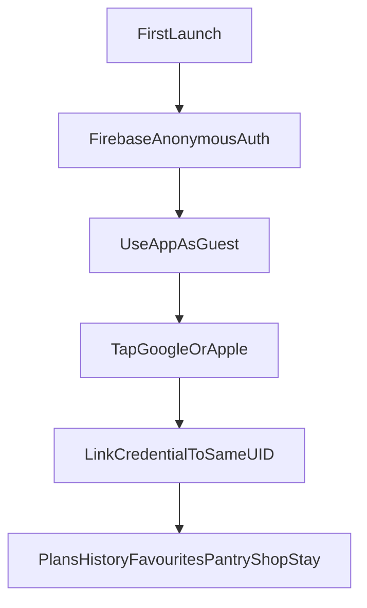

# Product Requirements Document — [App name]

**Working name:** `[App name]` (placeholder until chosen)  
**Tagline (EN):** Your Everyday Maharashtrian Food Companion  
**Tagline (MR):** तुमच्या रोजच्या महाराष्ट्रीय जेवणाचा साथीदार  
**Theme line:** आज काय बनवायचं?  
**Date:** 8 September 2026 (last updated 4 November 2026)  
**Status:** Living draft (defaults applied; see [Open questions](#35-open-questions))

---

## How to read this project

Each topic has **one owning file**. Other files link to it instead of restating it, so the docs do not drift apart.

| File | Owns |
|------|---------|
| [PRD.md](PRD.md) (this file) | Product, UX, functional requirements, product rules (meal model, grocery, offline policy, statuses), compliance |
| [ARCHITECTURE.md](ARCHITECTURE.md) | Firestore paths and data shapes, folder tree, layers, packages, auth/delete flow, offline implementation |
| [CONVENTIONS.md](CONVENTIONS.md) | Naming, code patterns, **analytics event list**, `GAFont` |
| [WORKPLAN.md](WORKPLAN.md) | Delivery order, milestones, exit criteria |
| [COSTS.md](COSTS.md) | Store fees, Firebase pricing, tools inventory, budget |

This app is a **single Flutter package** (not a Melos monorepo). Backend is **Firebase**, not a REST API.

**Releases:** [§5](#5-scope-mvp-v1-v2) splits **MVP** (first internal build), **V1** (first public product), **V2** (later). The domain model in MVP is already the V1 model so we do not redesign meals later.

---

## Table of contents

1. [Product overview](#1-product-overview)
2. [Goals and success metrics](#2-goals-and-success-metrics)
3. [Personas](#3-personas)
4. [Auth and personalization](#4-auth-and-personalization)
5. [Scope: MVP, V1, V2](#5-scope-mvp-v1-v2)
6. [Information architecture and UX](#6-information-architecture-and-ux)
7. [Meal model](#7-meal-model)
8. [Manual food entry](#8-manual-food-entry)
9. [Cook Now and cooking mode](#9-cook-now-and-cooking-mode)
10. [Pantry](#10-pantry)
11. [Replace meal](#11-replace-meal)
12. [Meal status](#12-meal-status)
13. [History](#13-history)
14. [Servings](#14-servings)
15. [Ingredients](#15-ingredients)
16. [Grocery list](#16-grocery-list)
17. [Recommendations](#17-recommendations)
18. [Search](#18-search)
19. [Functional requirements](#19-functional-requirements)
20. [Content and localization](#20-content-and-localization)
21. [Data model](#21-data-model)
22. [Offline and V1 sync policy](#22-offline-and-v1-sync-policy)
23. [Platforms and backend](#23-platforms-and-backend)
24. [Architecture summary](#24-architecture-summary)
25. [Non-functional requirements](#25-non-functional-requirements)
26. [Costing](#26-costing)
27. [Design direction](#27-design-direction)
28. [Authenticity](#28-authenticity)
29. [Acceptance criteria](#29-acceptance-criteria)
30. [Analytics](#30-analytics)
31. [Legal and store compliance](#31-legal-and-store-compliance)
32. [Assumed defaults](#32-assumed-defaults)
33. [Risks](#33-risks)
34. [Implementation order](#34-implementation-order)
35. [Open questions](#35-open-questions)

---

## 1. Product overview

Build a mobile app that is a **Maharashtrian meal planner, recipe book, grocery assistant, and food diary**. Users plan and track breakfast, lunch, dinner, and snacks; discover authentic Maharashtrian recipes; see ingredients and steps; generate a weekly plan and shopping list; cook from what they have; and use the app in **Marathi and English**.

A **meal is not always one recipe**. Lunch is often Varan + rice + bhaji + koshimbir. The product treats a meal as a **list of items** (recipes and/or manual food).

**Core loop:** Recipe(s) → Meal (items) → Day → Week → Ingredients → Shopping list → Tracking → History.

**Positioning:** a personal Maharashtrian food companion — not a generic recipe app and not a calorie counter.

**Problems it solves:**

1. आज नाश्त्याला काय बनवायचं?
2. दुपारी काय जेवायचं?
3. रात्री काय करायचं?
4. घरात जे आहे त्यातून काय बनवता येईल?
5. या recipe साठी काय काय लागेल?
6. या आठवड्याची भाजी/किराणा list काय आहे?
7. मी गेल्या आठवड्यात काय काय बनवलं?
8. मला महाराष्ट्रीय traditional recipes कुठे मिळतील?
9. माझ्या भागातले/region-specific पदार्थ कोणते? (tags in V1 data; browse UI in V2)
10. दररोज तेच पदार्थ repeat होऊ नयेत.

---

## 2. Goals and success metrics

**Product goals**

- Reduce daily “what to cook” friction
- Make authentic Maharashtrian cooking the default path
- Make grocery planning automatic from the week plan without wiping hand-added kirana items
- Keep plans, history, pantry, and favourites **personalized and synced** after Google/Apple link
- Record what the user **actually ate**, including food that is not in the catalog

**Primary funnel (V1):** recommendation shown → selected → cooked → eaten.

Targets are **starting assumptions** for the first 90 days after V1 launch. Revisit them after the first month of real data.

| Metric | How | Initial target |
|--------|-----|----------------|
| D7 / D30 retention | Firebase retention cohorts | ≥ 25% / ≥ 12% |
| Weekly active trackers | Users with ≥ 3 `track_meal_eaten` in a week ÷ WAU | ≥ 40% |
| Guest → Google/Apple conversion | `auth_account_linked` ÷ new users, within 14 days | ≥ 20% |
| Time to first planned meal | first `plan_recipe_added` after install | median < 3 min |
| Recommendation funnel | `cook_recommendation_shown` → `cook_recommendation_selected` → `track_meal_cooked` → `track_meal_eaten` | shown → selected ≥ 30% |
| Shopping list use (V1) | weekly users with `shopping_list_generated` ÷ weekly planners | ≥ 40% |
| Pantry cook (V1) | `pantry_recipe_selected` | tracked; no target yet |
| Search success | `recipes_search_completed` → `recipes_detail_viewed` (`source = search`) | ≥ 60% |
| Crash-free users | Crashlytics | ≥ 99.5% |

Event definitions: [CONVENTIONS.md § Analytics events](CONVENTIONS.md#analytics-events).

**Non-goals (through V1)**

- Medical nutrition or calorie counting as a core UX
- Social feed, comments, user-generated recipes
- Multi-user household accounts
- Custom backend (Node/Python/VPS)
- Ads or paid subscription
- Phone/SMS login
- AI / LLM recommendations

---

## 3. Personas

- **Weekday home cook** — needs breakfast / lunch / dinner decided, often as a small thali-like set of dishes, with a kirana list on Sunday
- **Pantry cook** — “घरात काय आहे?” with onion, potato, besan, jowar flour
- **Festival / seasonal cook** — wants authentic dishes (collection screens in V2; tags in V1 data)
- **Bilingual household** — Marathi names at home, English in the UI or both
- **Guest who later signs in** — uses the app first, links Google/Apple when they care about history
- **Diary user** — ate tea and leftover bhaji; that must still land in history without a recipe

---

## 4. Auth and personalization

**Default:** guest-first. Authentication must **not** block using the app.

**First launch**

1. Onboarding: language, vegetarian / non-vegetarian, region preference, household size, analytics consent ([§31](#31-legal-and-store-compliance))
2. Firebase **Anonymous Auth** creates a UID
3. The app is fully usable (plan, track, shop, pantry, favourites)

**Sign-in:** Profile offers Continue with Google and Continue with Apple. Credentials are **linked** to the **same** UID.

After a successful link, **keep** that anonymous user’s data. Do **not** create a new empty account. Preserve:

- plans
- history
- favourites
- shopping lists (derived and manual)
- pantry
- settings / profile

**iOS:** if Google sign-in is offered, Apple sign-in is required (App Store guideline 4.8). Android: Google required; Apple optional.

**Personalized (cloud, per user):** profile, preferences, daily/weekly plans, meal history and statuses, favourites, shopping lists, pantry, repeat-meal settings.

**Shared (not per user):** recipe catalog, ingredient catalog, season/festival/occasion/region tags on recipes.

**Link failure:** if Google/Apple already belongs to another UID, do **not** merge silently. Show a dialog that says, in plain words:

> “This Google/Apple account already has [App name] data. Sign in to it? The meals you added as a guest on this phone will **not** move to that account.”

Options: **Sign in to that account** (switches UID; guest data stays orphaned on the old anonymous UID) or **Cancel** (stay as guest, nothing changes). Never discard guest data without this explicit choice.

**Guest + uninstall:** data is lost unless they linked. Say this in onboarding.

**Account deletion:** in-app, needs network. Deletes all of `users/{uid}` and the Auth user. Google/Apple users re-confirm sign-in first; Apple users also get their Sign in with Apple token revoked (Apple requirement). Steps: [ARCHITECTURE.md §8](ARCHITECTURE.md#8-auth-in-code).

---

## 5. Scope: MVP, V1, V2

Three trains. **The meal/item data model ships in MVP** so V1 and V2 do not migrate it.

### MVP — first internal / TestFlight build

Prove the daily loop on one device, with the real domain model underneath.

- Guest + Google + Apple auth and cloud sync (same UID on link)
- Onboarding (language, diet, region, household size)
- Home: today’s breakfast, lunch, dinner
- Recipe catalog + detail (ingredients, steps, servings)
- Tolerant search (EN / MR / transliteration / spacing)
- Bilingual UI (EN, MR, EN+MR)
- **Meal = `meal_items[]`** from day one (one item is enough in the UI)
- Track: Planned / Cooked / Eaten / Skipped; mark eaten; history snapshot
- Cook Now → cooking mode (ingredients, steps, servings, Mark Cooked / Eaten) without needing a week plan
- Cook Now suggestions with **simple ranking**: filter by meal type, time, diet; drop recipes eaten within the repeat window. (Full ranking in V1, [§17](#17-recommendations))
- Repeat-meal setting (default: 3 days)
- Bottom nav: Home, Recipes, Track. Profile / language / auth in overflow
- Analytics + Crashlytics
- Bundled recipe catalog works offline from first launch
- Ingredient **IDs** on every catalog recipe (normalization from day one)
- Region, season, festival, occasion **tags on recipes** (no browse hubs)

**Out of MVP:** Replace meal, weekly calendar UX, grocery list, pantry UI, multi-dish editor, manual food, favourites, generate/copy/randomize week, share list. In MVP the user changes a slot by removing its recipe and adding another.

### V1 — first public store product

Everything in MVP, plus a coherent planner + diary + kirana product.

- Multi-item meals in the UI (Varan + rice + bhaji + koshimbir)
- Manual food on a slot (tea, leftover bhaji) — not a Recipe
- Weekly planner: replace, generate, copy previous week, randomize, servings
- Favourites + add to plan
- Snacks (morning / evening) on Track; Home can stay three mains
- Pantry: add/remove/search ingredients; match recipes; missing counts; independent of the week plan
- “आज काय बनवायचं?” using the ranked recommendation engine (and pantry when set)
- Replace meal using the **same** engine; grocery updates after replace
- Grocery list: **derived vs manual**; plan changes update derived only
- Serving size carried across recipe → plan → grocery → Cook Now
- Full offline for cached recipes, plans, track, pantry, shopping list; queue sync
- Recommendation ranking in [§17](#17-recommendations)
- Product-loop analytics in [§30](#30-analytics)

### V2 — later

- Regional browse / hub UI
- Thali builder UI (“आपली थाळी तयार करा”) — **uses V1 `meal_items`**, no model rewrite
- Seasonal and festival **collection screens**
- Food statistics (“माझा आहार”)
- Advanced recommendation scoring (day of week, region, festival, household size as extra weights)
- Family / household profiles
- Nutrition tracking UI
- Cloud Functions, FCM reminders, Remote Config
- Phone auth, Identity Platform MFA
- In-app subscription / ads
- Cloud Storage for remote recipe photos

V1 structures must not block V2. Do not implement V2 UIs now.

---

## 6. Information architecture and UX

**Bottom navigation:** MVP: Home, Recipes, Track. V1 adds Plan and Shopping → Home, Recipes, Plan, Track, Shopping. Profile / language / auth live in an overflow menu in both. Pantry lives under Home (“घरात काय आहे?”) and/or Recipes; not a sixth tab.

**Home**

- Greeting + date
- Today’s meals: breakfast, lunch, dinner — show **item names** (not only one recipe), photo from the first recipe item if any, status, View, Replace, Mark eaten
- आज काय बनवायचं? / Cook Now
- घरात काय आहे?
- This week (V1)
- Shopping remainder (V1)

**Recipe screen:** photo, names, tags, time, servings adjuster, ingredient checklist, add to shopping list (V1), steps, Favourite / Add to plan (V1) / Cook Now / Mark as eaten.

**Cooking mode:** see [§9](#9-cook-now-and-cooking-mode).

**Auth:** do not block first use. Light prompt after the user saves a plan or marks a meal.

**Language modes:** English, Marathi, Marathi + English (e.g. Kanda Poha / कांदे पोहे).

---

## 7. Meal model

**A meal is not `recipe_id`. A meal is `meal_items[]`.**

Examples:

- Varan + rice + bhaji + koshimbir
- Pithla + bhakri + thecha
- Amti + rice + batata bhaji
- Bhakri + bharit + thecha
- One recipe only (Kanda Poha) — still a list of length 1

Each **meal item** is one of:

| Kind | Fields |
|------|--------|
| Catalog recipe | `recipeId`, `servings` (override), optional display snapshot (nameEn, nameMr) |
| Manual food | `label` (free text), optional quantity text; **no** `recipeId` |

The **meal** (a slot on a date) has: `date`, `mealType` (breakfast / morning snack / lunch / evening snack / dinner), `status`, `items[]`, `servings` default inherited from household unless overridden.

This model is used by daily planning, weekly planning, tracking, grocery generation (recipe items only), history, favourites (recipe items), and later Thali Builder (V2 composes `meal_items`).

Do not build Thali Builder in V1.

---

## 8. Manual food entry

**V1.** Users must record food that is **not** in the catalog.

Examples: “Tea”, “2 eggs”, “Leftover bhaji”.

Rules:

- Simple name (and optional free-text quantity)
- Belongs to a meal slot
- Has the same **meal status** as the slot (or the slot status covers the whole meal)
- Appears in history
- Does **not** create a Recipe
- Does **not** contribute ingredients to the grocery list
- Does **not** require cooking instructions

The diary stays useful when the catalog is incomplete.

---

## 9. Cook Now and cooking mode

**MVP** (single recipe, simple ranking); **V1** adds multi-item sessions and full ranking. Not an AI feature. The user does **not** need a weekly plan to cook.

**Cook Now**

1. User picks meal type / time / context (or starts from a recipe)
2. App recommends what to cook **now** (rule-based; MVP simple ranking in [§5](#5-scope-mvp-v1-v2), V1 in [§17](#17-recommendations))
3. User selects a recipe (V1: or a suggested combination)
4. Recipe (or first recipe of a combo) opens in **cooking mode**

**Which slot does Cook Now write to?** The slot for today and the chosen meal type:

- **Empty slot** → the recipe is added to it (status Planned until Mark Cooked / Eaten)
- **Slot already has different items** → ask: “Replace today’s lunch with Thalipeeth?” MVP: **Replace** or **Cancel**. V1 adds **Add to this meal**
- **Slot already contains this recipe** → just open cooking mode on it

**Cooking mode** prioritizes:

- Ingredients and quantities (scaled to current servings)
- Step-by-step instructions
- Serving size (editable; persists on that meal / item)
- Step completion / progress
- **Mark Cooked** — applies to the **meal slot**, not each dish separately
- **Mark Eaten** — applies to the **meal slot**

**Multi-item meals (V1):** if the slot has several catalog recipes, cooking mode is **one session** for that meal:

- List every recipe item on the meal
- Open each recipe’s ingredients and steps in turn
- Keep each item’s serving quantities
- The user can go through recipes sequentially
- Do **not** build timers, parallel-dish orchestration, or per-item cooked/eaten workflows

A single-recipe meal uses the same screen with one item.

---

## 10. Pantry

**V1.** First-class, usable **without** the weekly planner.

Users can add, remove, and search/select ingredients (by ingredient ID, bilingual).

From the current pantry, show recipes that can be made, **missing ingredient counts**, and sort by **fewest missing**.

Example:

Pantry: poha, onion, potato, peanuts  

- Kanda Poha — 0 missing  
- Batata Poha — 0 missing  
- another recipe — 2 missing  

Pantry also feeds “What should I cook?” when the user has pantry items.

---

## 11. Replace meal

**V1.** Not in MVP (in MVP the user removes the recipe and adds another).

When the user taps Replace:

- Keep the same date and meal slot
- Keep constraints (meal type, diet, time if known, repeat window)
- Show **ranked alternatives**, not a random list
- User picks one (recipe or multi-item suggestion)
- Plan updates
- Grocery list **derived** lines update; **manual** grocery lines stay

---

## 12. Meal status

Statuses: **Planned**, **Cooked**, **Eaten**, **Skipped**.

Allowed without a heavy state machine:

| From | To |
|------|-----|
| Planned | Cooked, Eaten, Skipped |
| Cooked | Eaten, Skipped, Planned (undo) |
| Eaten | Planned / Cooked / Skipped (fix a mistake) |
| Skipped | Planned / Cooked / Eaten |

Typical happy path: Planned → Cooked → Eaten. Users may mark Planned → Eaten directly.

Status is stored **once**, on the slot itself, with a `statusChangedAt` timestamp. History reads the same record ([§13](#13-history)), so there is no second copy to keep in sync on undo or replace.

---

## 13. History

History is **what they ate (or skipped)**, not a live view of the plan.

If Monday’s plan was Kanda Poha and they replace it with Thalipeeth and mark eaten, history is Thalipeeth.

History is the **day records for past dates** — the same records the planner and tracker use, not a separate copy. Because each day record holds exactly what is on the slot, a replaced meal shows the replacement.

If a catalog recipe is later edited (new steps, renamed), **old history must not change**. So every meal item stores:

- `recipeId` when it was a catalog item (optional lookup)
- **Snapshot:** nameEn, nameMr, servings at the time it was added
- Manual items as their label

Favourites stay on live recipes. History does not. Data shape: [ARCHITECTURE.md §6](ARCHITECTURE.md#6-data-cloud-vs-phone).

---

## 14. Servings

One rule everywhere: recipe detail, add to plan, weekly plan, grocery, Cook Now, multi-item meals.

`scaledQty = recipeQty × (itemServings / recipeBaseServings)`

`itemServings` defaults to **household size** and does not reset when moving between those screens. The user can override per meal or per item.

Then grocery **sums** `scaledQty` by **ingredient ID + unit** (not by display name). Quantities in different units are only combined when the ingredient defines a conversion (e.g. g ↔ kg); otherwise they stay as separate lines (“Onion 1 kg”, “Onion 2 pc”). Non-quantified amounts (“to taste”) appear once, without a number.

Manual food has no scaled ingredients.

---

## 15. Ingredients

Grocery and pantry join on **stable ingredient IDs**, never on display strings.

“Onion”, “कांदा”, and “Kanda” are one ingredient.

Each ingredient:

- `ingredientId`
- `nameEn`, `nameMr`
- `aliases[]` (transliterations and spellings)
- `category` (grains, pulses, vegetables, spices, …)
- `commonUnits[]`

Recipes reference `ingredientId` + quantity + unit. Search and grocery aggregation use the same IDs.

---

## 16. Grocery list

**V1.** One **active shopping list per planned week**. Generating or updating the list **updates that week’s list**; it does not create a new list every time.

The Firestore path may stay `shoppingLists/{listId}` so V2 can keep history or multiple lists. V1 only **exposes** the list for the current week (id can be the week start date).

Contents:

- **Derived** lines from that week’s recipe meal items
- **Manual** lines the user added

| Type | Source | When the plan changes |
|------|--------|------------------------|
| **Derived** | Recipe ingredients, scaled and aggregated by ingredient ID + unit | Recalculate on the **same** week list: new recipes add lines; removed recipes drop their derived qty; serving changes update qty. Check-off on a derived line is kept if that ingredient + unit is still needed |
| **Manual** | User typed or added | **Remain**, including checked state, unless the user deletes them |

Users can check off, edit quantity, remove a line, add custom items, group by category, share/export.

Do not destroy manual items when the week plan is regenerated.

---

## 17. Recommendations

**Rule-based, on device. No LLM.**

Deterministic rank when several recipes match. Apply filters then score. V1 order:

1. Meal type
2. Time budget
3. Dietary preference
4. Pantry availability (fewer missing = higher)
5. Repeat-meal restriction. Settings:
   - **Off** — repeats allowed; no filter
   - **3 days** (default) / **7 days** — hard filter: recipes eaten within the window are not suggested
   - **Flexible** — no hard filter; recently eaten recipes are ranked lower (rule 7)
6. Season when tagged and current season is known
7. Recent meal avoidance (even inside the flexible window)
8. Favourites (light boost, V1)
9. Variety (do not fill a week with one dish)

**V2 extra weights:** day of week, region preference, festival, household size as a scoring signal (servings already apply in V1).

Replace meal uses this same engine.

If the user ate Poha yesterday, do not lead with Poha unless it is a favourite, pantry-forced, or they asked for it.

---

## 18. Search

English, Marathi, and transliteration must hit the same recipe.

Also tolerate: capitalization, hyphen vs space (`kanda-poha` / `kanda poha`), minor spacing, aliases, common spellings (`pithla` / `pithale` / `पिठलं`).

Not an AI search engine. On-device search over normalized names and aliases of the bundled catalog, with a small typo tolerance. Works offline.

---

## 19. Functional requirements

IDs are testable. **Release** column is the first train that must satisfy the requirement.

| ID | Release | Requirement |
|----|---------|-------------|
| AUTH-1 | MVP | Create anonymous Firebase user on first launch; app usable without Google/Apple |
| AUTH-2 | MVP | Link Google to the same UID; keep plans, history, favourites, shop, pantry |
| AUTH-3 | MVP | Link Apple to the same UID (required on iOS) |
| AUTH-4 | MVP | If provider already belongs to another UID, refuse silent merge |
| AUTH-5 | MVP | Sign out; delete account and user documents |
| HOME-1 | MVP | Show today’s breakfast, lunch, dinner with status and item names |
| HOME-2 | V1 | Replace meal via recommendation engine; grocery derived lines update |
| MEAL-1 | MVP | Statuses Planned / Cooked / Eaten / Skipped with [§12](#12-meal-status) |
| MEAL-2 | V1 | Manual food on a slot without creating a Recipe |
| MEAL-3 | V1 | Snack slots on Track |
| MEAL-4 | MVP | Meal contains `meal_items[]` (length ≥ 1 in normal use) |
| MEAL-5 | V1 | User can add multiple catalog recipes to one slot |
| REC-1 | MVP | Recipe fields including region(s), season, festival, occasion tags, aliases |
| REC-2 | MVP | Adjust servings; value persists into plan / Cook Now; grocery in V1 |
| REC-3 | V1 | Favourite / unfavourite; add favourite to plan |
| ING-1 | MVP | Ingredients have stable IDs, EN/MR names, aliases, category, units |
| SRC-1 | MVP | Search EN, MR, transliteration, spacing/hyphen/case, aliases |
| SRC-2 | V1 | Filters: meal, time, difficulty, diet, season, occasion |
| PLAN-1 | V1 | Weekly grid breakfast / lunch / dinner |
| PLAN-2 | V1 | Generate week, copy previous week, randomize, avoid repeats, servings |
| PLAN-3 | V1 | Grocery from week; derived vs manual |
| SHOP-1 | V1 | Aggregate by ingredient ID; group by category |
| SHOP-2 | V1 | Check off, add manual, remove, edit qty, share; regeneration keeps manuals |
| SHOP-3 | V1 | One active list per planned week; generate/update that list, do not spawn a new list each time |
| COOK-1 | MVP | Cook Now → cooking mode without a week plan; simple ranking (meal type, time, diet, repeat window); slot rules in [§9](#9-cook-now-and-cooking-mode) |
| COOK-2 | V1 | आज काय बनवायचं? with ranked suggestions |
| COOK-3 | V1 | Pantry CRUD + match + missing counts + fewest extras |
| COOK-4 | V1 | Multi-item cooking session: sequential recipes; Mark Cooked / Eaten on the slot |
| HIST-1 | MVP | History = past day records; meal items snapshot names/servings; catalog edits do not change history |
| I18N-1 | MVP | UI EN / MR / both; natural Marathi ingredient names |
| OFF-1 | MVP | Browse/search/cook recipes offline, including on first launch (bundled catalog) |
| OFF-2 | V1 | Firestore persistence for user docs; immediate local edits; queue sync; quiet waiting-to-sync; last-write-wins; no custom sync engine |
| V2-THALI | V2 | Thali builder UI |
| V2-STATS | V2 | Food history statistics |
| V2-FEST | V2 | Festival / season collection screens |
| V2-REGION | V2 | Regional browse hub |

---

## 20. Content and localization

- UI strings: ARB English + Marathi
- Recipe and ingredient **content** is bilingual in Firestore, not only ARB
- Search aliases on recipes **and** ingredients
- **Catalog size:** MVP seed ~15–20; V1 target ~40–80 authentic dishes covering breakfast, lunch, dinner, veg and non-veg, and major regions
- **Catalog ships inside the app** (JSON asset). Firestore carries only updates between app releases
- Regions are **one or more tags per recipe**. Maharashtra is not one cuisine
- Festival, season, occasion tags in V1 data; collection UIs in V2
- Seed images **bundled** through V1
- You write or commission copy and photos. Do not scrape other recipe sites

**Regions (data, V1):** Pune, Western Maharashtra, Maval, Konkan, Malvan, Kolhapur, Khandesh, Nashik, Marathwada, Vidarbha, Nagpur, Varhadi, Ahirani/Khandeshi.

---

## 21. Data model

Exact Firestore paths and field shapes live in [ARCHITECTURE.md §6](ARCHITECTURE.md#6-data-cloud-vs-phone). Product-level summary:

**Shared catalog** (bundled in the app, updates via Firestore): recipes (bilingual names, aliases, ingredient lines by ingredient ID, steps, times, region/diet/season/festival/occasion tags, image) and ingredients (bilingual names, aliases, category, units, optional seasonal months).

**Per user** (under the user’s UID):

| Data | Notes |
|------|-------|
| Profile | Language, diet, region preference, household size — exactly what onboarding collects |
| Settings | Repeat policy, language mode |
| Days | One record per date; each slot holds status + meal items. **Single source** for plan, track, and history |
| Favourites | Live recipe references |
| Shopping lists | One per planned week; derived + manual lines |
| Pantry | Ingredient IDs the user has |

**Security:** catalog readable by any signed-in user (including anonymous); user data only by its owner. No client writes to catalog.

**V2 extension points (do not build now):** extra profile members; nutrition fields already optional on recipes; thali templates as saved `meal_items` presets; stats as queries over history snapshots.

---

## 22. Offline and V1 sync policy

The UI must not look broken when Firebase is unreachable — including on first launch, because the recipe catalog is bundled.

**Do not build a custom offline sync engine in V1.** Use **Firestore offline persistence** for user-owned documents (implementation rules: [ARCHITECTURE.md §7](ARCHITECTURE.md#7-firestore-offline-implementation-rules)). Do not add Cloud Functions or another sync service only for offline.

**V1 policy**

- User edits **appear immediately** while offline (local cache / persistence).
- Firestore **queues** supported writes and syncs them when connectivity returns.
- Cached data stays usable offline (bundled catalog; user docs via persistence).
- If sync is pending or fails, show a quiet **“waiting to sync”** state — not a full-screen error.
- **No custom conflict-resolution UI** in V1.
- If the same user edits the same field on two devices, **standard Firestore last-write-wins** is acceptable. Writes are per field, so edits to *different* meals or shopping lines on two devices both survive.
- Operations that **need** network: first anonymous sign-in, account link, account delete.

**MVP offline:** browse and search recipes; open ingredients and steps; cook mode; mark cooked/eaten on today’s slot (queued by Firestore).

**V1 offline:** also view/edit current plans, pantry, shopping list, and tracking.

---

## 23. Platforms and backend

No custom server through V1. One Firebase project per environment (dev, prod) provides Auth (Anonymous, Google, Apple), Firestore, Analytics, Crashlytics, and App Check. Cloud Storage, FCM, Remote Config, and Cloud Functions are V2. What to configure vs code, and what **not** to add: [ARCHITECTURE.md §12–13](ARCHITECTURE.md#12-packages).

---

## 24. Architecture summary

Flutter iOS + Android, single package, Clean Architecture with BLoC; Firestore for user data; recipe catalog bundled in the app. Full detail: [ARCHITECTURE.md](ARCHITECTURE.md).

---

## 25. Non-functional requirements

- Offline as in [§22](#22-offline-and-v1-sync-policy)
- Devanagari + Latin; natural Marathi
- Auth link must not drop guest data
- Personal meal data only under that UID
- **No ATT prompt:** the app does not collect the advertising identifier (IDFA) or track users across apps. Re-evaluate if ads are ever added
- Recipe catalog is never fetched in full from Firestore on screen open
- Grocery join on ingredient ID + unit, not strings
- Home and recipe screens usable within 2 s of cold start on a mid-range Android device

---

## 26. Costing

Through V1 the app is free, with no ads or in-app purchases. Expected fixed cost in the launch year is about **$124** (Apple $99/year + Google Play $25 once) plus tax; Firebase should stay at **$0–10/month** with budget alerts. Full breakdown, quotas, tools, and V2 monetization notes: [COSTS.md](COSTS.md).

---

## 27. Design direction

Warm, homely, traditional but modern, simple, family-friendly. Not a Western calorie app.

Subtle Maharashtrian cues (Warli-inspired pattern, Devanagari labels, food photography) without clutter. Usability first.

Follow Design System 2.0 for components and tokens. Apply fonts only via **`GAFont`**.

---

## 28. Authenticity

Real Maharashtrian traditions, not generic Indian recipes with a Maharashtra label.

Each recipe should have region(s), local Marathi name, traditional ingredients and method, common variations, serving combinations. Where variations are common (e.g. Pithla), show them — do not claim one household’s version is the only authentic one.

---

## 29. Acceptance criteria

V1 is successful when these loops work end to end.

**Loop A — plan and eat**

Home → see today’s meal → replace or choose → open recipe → adjust servings → Cook Now / cooking mode → Mark Cooked → Mark Eaten → meal appears in History (snapshot of what was eaten) → weekly plan contains the meal → grocery list reflects those recipes and servings.

**Loop B — pantry**

Home → “घरात काय आहे?” → enter pantry ingredients → matching recipes → missing ingredients → select recipe → cook.

**Loop C — grocery integrity**

Weekly plan → change a recipe → **that week’s** shopping list updates derived quantities → **manual** shopping items and their checked state remain. Generating the list again updates the same week list, it does not create a second list.

**Loop D — diary without catalog**

Track → add “Tea” / leftover bhaji → status Eaten → history shows that label → grocery unchanged.

**Loop E — auth**

Use as guest (plan + history) → link Google or Apple → same data present. Linking a provider that already owns another account does not wipe or merge silently.

---

## 30. Analytics

Instrument the core loop, not only screens. Funnel: **recommendation shown → selected → meal cooked → meal eaten**.

The event names, parameters, and the release each is needed in are owned by [CONVENTIONS.md § Analytics events](CONVENTIONS.md#analytics-events). Names use Firebase-valid `snake_case` (e.g. `track_meal_eaten`).

Do not log health claims, names, emails, or full pantry dumps. Analytics collection respects consent ([§31](#31-legal-and-store-compliance)).

---

## 31. Legal and store compliance

- Public **privacy policy** and **support URL**
- **Account deletion** in-app, plus a web deletion request path (Google Play requires one). Sign in with Apple token revocation on delete
- Meal history and pantry are **personal data**
- Play Data safety + App Store privacy nutrition labels: Auth, Analytics, Crashlytics, Firestore
- **India — DPDP Act 2023** (primary market): clear notice of what is collected and why, consent for non-essential processing, a way to withdraw consent and delete data, a contact for grievances. Check the current DPDP Rules before launch
- **EU — GDPR** (developer is in UTC+2 — assume some EU installs): lawful basis, export/delete. Analytics needs **opt-in consent** for EU users; keep Analytics collection off until they agree (Firebase Consent Mode). Crashlytics can run under legitimate interest — state it in the privacy policy
- One consent prompt in onboarding covers both: “Help improve the app by sharing usage data?” (not “anonymous”: Analytics data is pseudonymous, tied to an app instance) Default **off** in the EU, and never required to use the app
- Recipe text and photos: you must have the right to use them
- Age rating: likely 4+ / Everyone if no alcohol-focused content; confirm at submission

---

## 32. Assumed defaults

| Topic | Default |
|-------|---------|
| Working name | `[App name]` (placeholder) |
| Audience | India first (Maharashtra + diaspora) |
| Default UI language | English, with Marathi and bilingual modes |
| Firebase region | `asia-south1` (Mumbai) — Firestore location cannot be changed later |
| Recipe authors | Founder-curated; MVP ~15–20, V1 ~40–80 |
| Week start | Monday |
| “Today” | Device timezone |
| Monetization | Free, no ads through V1 |
| OS | iOS 15+, Android 8 (API 26)+ |
| Images | Bundled through V1 |
| Environments | Separate Firebase **dev** and **prod** projects |
| Repeat default | 3 days (hard filter) |
| Analytics consent | Opt-in in the EU; notice + opt-out elsewhere |

---

## 33. Risks

- Authentic copy and photography take more time than engineering — run content as its own workstream from Setup ([WORKPLAN.md](WORKPLAN.md#content-workstream-runs-in-parallel))
- Grocery units (cups vs grams vs “to taste”) even with ingredient IDs — mitigated by ID + unit aggregation ([§14](#14-servings))
- Transliteration coverage
- Anonymous → existing Google/Apple account conflict
- Multi-item meals vs grocery double-counting shared staples (oil, salt) — accept staple overlap or cap pantry staples later; do not block V1
- Guest users who never link and then uninstall
- Firestore write calls never complete while offline — UI code must not wait on them ([ARCHITECTURE.md §7](ARCHITECTURE.md#7-firestore-offline-implementation-rules))

---

## 34. Implementation order

1. Meal / `meal_items` data model on day records (including name/servings snapshots)
2. Planning + tracking + history consistency (MVP daily; V1 weekly)
3. Pantry + Cook Now
4. Grocery synchronization (derived vs manual)
5. Ingredient normalization (IDs in catalog from step 1; aggregation in step 4)
6. Recommendation + replace
7. Search tolerance
8. Auth / data preservation (scaffold early; verify after data exists)
9. Offline behaviour
10. Analytics + acceptance criteria

Flutter scaffold and Firebase **dev** project sit under step 1. Do not create Apple/Play accounts until TestFlight / closed test.

---

## 35. Open questions

| Question | Default until decided |
|----------|----------------------|
| Final app name and store listing name | `[App name]` |
| Bundle ID / applicationId | `[bundle.id.tbd]` |
| Company vs individual developer accounts | Individual is enough to start |
| Recipe photo source | Founder photos or licensed stock — confirm before launch |
| Exact seed recipe list | To be curated |
| Marathi copy reviewer | Needed; do not ship literal machine translation |
| Publish Android-first vs both stores together | Both from day one of **code**; store submit Android first if Apple $99 is deferred |
| GDPR representative / DPA if you scale in EU | Not needed on day one; revisit with users |
| How aggressively to merge staple ingredients (oil, salt, turmeric) on the grocery list | Sum everything in V1; refine in V2 |

---

*End of PRD.*
